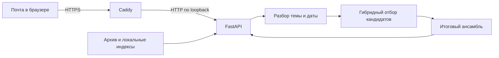

# Архитектура выпуска v1.1

Веб-приложение показывает архив организаторов: 12 ящиков и 16 376 писем. В браузере можно выбрать ящик, выполнить поиск, открыть письмо и посмотреть похожие письма. На VPS Caddy принимает HTTPS, а FastAPI обслуживает интерфейс, статику и API поиска из одного контейнера. Архив и модели подключаются к контейнеру для чтения.



## Поисковый запрос

1. **Область поиска.** Парсер выделяет тему и календарный период. Движок учитывает выбранный ящик и исключает письма, полученные позже даты запроса. «Вчера» и похожие выражения отсчитываются от даты поиска.
2. **До 30 кандидатов с датой.** Письма из нужного периода получают приоритет. Для них смешиваются нормализованные оценки обычного BM25 (**91,5%**) и BM25 с семантическими совпадениями отдельных слов (**8,5%**). Семантический канал использует русские векторы Navec. Например, он может дать частичное совпадение словам с разными корнями.
3. **Сортировка тридцатки.** При слабом совпадении запроса с темами ансамбль смешивает три порядка с весами **35% `period` / 20% `period:cover` / 45% `context`**. Два первых порядка используют текстовые признаки, третий добавляет близость векторов. При сильном совпадении сохраняется текстовый порядок `period` внутри выбранного пула.
4. **Запросы без даты.** Ансамбль объединяет кандидатов BM25, RuBERT и контекстного векторного индекса, учитывая свежесть письма.

RuBERT Tiny Retriever кодирует запрос во время поиска. Векторы писем готовятся заранее из темы и начала текста. Контекстный адаптер обучен с использованием Qwen; при ответе API используются локальные компактные модели и готовый индекс. [Отбор кандидатов](../solutions/semantic_ensemble/README.md) · [Контекстный индекс](../solutions/tiny_encoder/QWEN_CONTEXT.md)

## Запуск контейнера

Подготовьте модели и индекс по [инструкции гибридного поиска](../solutions/semantic_ensemble/README.md). Каталог `models/` должен содержать `rubert-tiny-retriever/`, `tiny-fast.npz` и `navec.tar`. Индекс строится из того же архива, который подключается как `data/`.

```sh
docker build -f deploy/Dockerfile -t vk-mail-v1.1 .
docker run --rm -p 127.0.0.1:8000:8000 \
  --mount "type=bind,source=$PWD/data,target=/data,readonly" \
  --mount "type=bind,source=$PWD/models,target=/models,readonly" \
  vk-mail-v1.1
```

Интерфейс откроется на `http://127.0.0.1:8000/`. [Публичное приложение](https://vk-mail.597d550b.sslip.io/)
